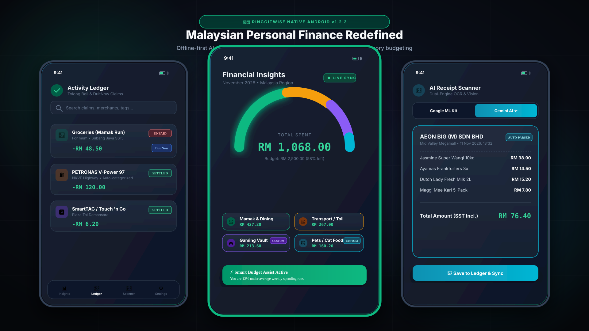
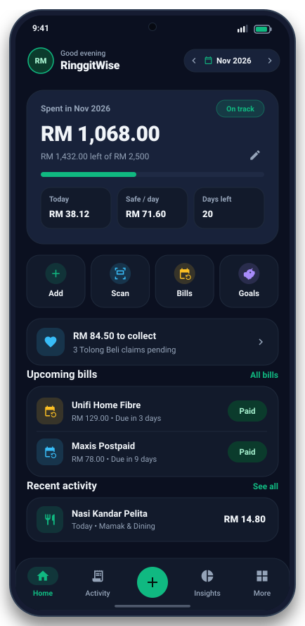
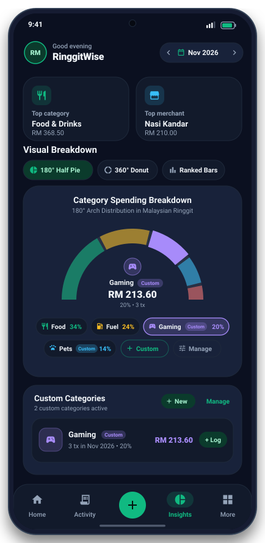
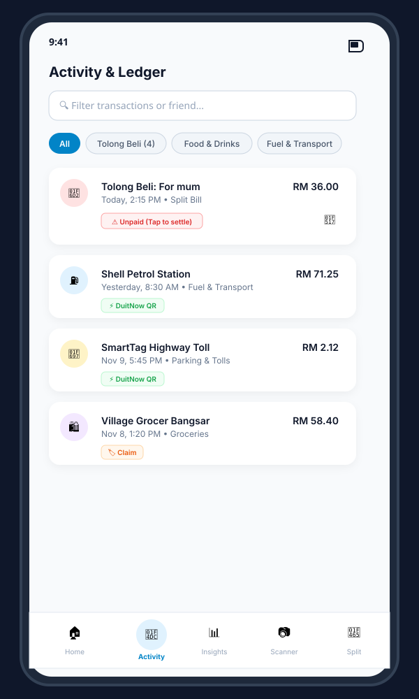

# 🇲🇾 RinggitWise — Malaysian Personal Finance, DuitNow QR & AI Scanner

[](https://github.com/Kwan-desu/RinggitWise/releases/tag/v1.2.3)
[-3DDC84?logo=android&logoColor=white)](https://developer.android.com)
[](https://kotlinlang.org)
[](https://developer.android.com/jetpack/compose)
[-10B981)](#)
[](#)
[](LICENSE)

A modern, privacy-first **Native Android application** built strictly in **Malaysian Ringgit (RM)**. Features an **interactive 180° Half Pie and 360° Donut spending breakdown with full Custom Category support**, a **Tolong Beli (Help Buy)** claim system with 1-tap WhatsApp sharing, a **Dual-Engine AI Receipt Scanner** (100% Offline Google ML Kit OCR + Google Gemini AI multimodal assistant), **Recurring Bill Reminders**, **Savings Goals**, and **Material You wallpaper frosted-glass styling**.

---

## 📱 App Preview

<div align="center">
  
</div>

<br/>

<div align="center">
  <a href="https://github.com/Kwan-desu/RinggitWise/releases/download/v1.2.3/RinggitWise-v1.2.3.apk">
    
  </a>
</div>

---

## 📸 Key Screen Previews

<div align="center">
  <table>
    <tr>
      <th align="center" width="25%">🏠 Home & Budget</th>
      <th align="center" width="25%">📊 Insights & Custom Categories</th>
      <th align="center" width="25%">👥 Activity & Tolong Beli</th>
      <th align="center" width="25%">⚡ AI & OCR Scanner</th>
    </tr>
    <tr>
      <td align="center"></td>
      <td align="center"></td>
      <td align="center"></td>
      <td align="center"></td>
    </tr>
    <tr>
      <td align="center"><sub>Monthly RM budget pace, daily safe spend, quick actions & upcoming bills</sub></td>
      <td align="center"><sub>180° Arch & 360° Donut with custom category slices & interactive center focus</sub></td>
      <td align="center"><sub>Tolong Beli claim tracking, settlement status & payment method pills</sub></td>
      <td align="center"><sub>100% offline local OCR (ML Kit) + Google Gemini AI multimodal analysis</sub></td>
    </tr>
  </table>
</div>

---

## ✨ Features & Capabilities

### 1. 📊 Interactive Insights with Custom Categories (v1.2.3)
- **180° Half Pie & 360° Donut Charts**: Proportional arch distribution rendering your spending breakdown cleanly.
- **Full Custom Category Integration**: Any user-created custom category automatically renders in chart slices with its custom vector icon and chosen color.
- **Interactive Focus on Tap**: Tap any category chip below the chart to focus the center on that category's exact RM amount, percentage of monthly spend, transaction count, and a 1-tap **`+ Log`** shortcut.
- **Ranked Bars Mode**: Ranks spending by category `#1`, `#2`... followed by custom categories with direct logging buttons.
- **Daily Spending Timeline**: 31-day burn rate chart identifying peak spending days in Malaysian Ringgit.
- **Dedicated Custom Categories Section**: Manage, create, and track monthly spending across all custom categories right on the Insights tab.

### 2. 👥 Tolong Beli (Help Buy) Social Claims
- **Peer & Family Expense Tracking**: Mark any expense as **Tolong Beli** with recipient name (e.g. *Mum*, *Roommate*, *Bro*).
- **Payment Method Badges**: Clear visual badges for **DuitNow QR**, **Touch 'n Go eWallet**, **MAE**, **Debit Card**, and **Cash**.
- **1-Tap WhatsApp Claim Sharing**: Generates an instant friendly WhatsApp message with transaction date, items, exact RM amount, and your DuitNow payment details.
- **Settlement Tracking**: 1-tap status switch between **Unpaid** and **Settled**.

### 3. ⚡ Dual-Engine AI Receipt Scanner
- **Engine 1: Google ML Kit OCR (100% Offline)**
  - Local, high-speed on-device text recognition.
  - Zero internet required — completely private with no data sent to external servers.
  - Recognizes receipts from **Touch 'n Go eWallet**, **MAE by Maybank**, **CIMB OCTO**, **GrabPay**, and retail slips.
- **Engine 2: Google Gemini AI Multimodal Analysis**
  - Powered by Gemini models (`gemini-2.5-flash`, `gemini-3.5-flash-lite`, etc.) with customizable API key.
  - Automatically parses messy itemized grocery or mamak receipts into structured line items.
  - Conversational AI financial assistant: ask *"How much did I spend on dining this month?"* or paste a statement for instant breakdown.

### 4. ⏰ Recurring Bills & Savings Goals
- **Android WorkManager Notifications**: Schedule recurring utility, rent, and subscription bills with background notifications so you never miss a payment.
- **Savings Goals**: Track milestones for emergency funds, vacations, or gadget goals with interactive progress meters.

### 5. 🎨 Material You & Frosted Glass Design
- **Wallpaper Adaptive**: Dynamic color extraction adhering strictly to Android Material You design guidelines.
- **Frosted Glass Cards**: Adjustable glass opacity with translucent surface overlays.
- **All Rounded Elements**: Pure Material vector icons (zero placeholder emojis) with cohesive squircle shapes.
- **Theme Modes**: Dark Mode, Light Mode, and System Default.

### 6. 🔄 In-App Auto-Updater
- RinggitWise automatically checks for new releases directly via the GitHub Releases API.
- Download and install updates directly within the app without manually opening a browser.

---

## 📥 Installation

Download the ready-to-install debug APK from the latest release:

- **Latest APK**: [RinggitWise-v1.2.3.apk](https://github.com/Kwan-desu/RinggitWise/releases/tag/v1.2.3)
- **Minimum Android Version**: Android 8.0 (API level 24)
- **Target Android Version**: Android 16 (API level 36)

---

## 🛠️ Building from Source

### Prerequisites
- Android Studio Ladybug (or newer) / JDK 17+
- Android SDK Platform 36

### Build Steps

```bash
# 1. Clone the repository
git clone https://github.com/Kwan-desu/RinggitWise.git
cd RinggitWise

# 2. Navigate to native android directory
cd native-android

# 3. Assemble debug APK
./gradlew assembleDebug

# Output APK location:
# app/build/outputs/apk/debug/app-debug.apk
```

---

## 🏗️ Architecture & Tech Stack

| Component | Technology |
|---|---|
| **Language** | Kotlin 2.0 |
| **UI Framework** | Jetpack Compose (Material 3) |
| **Offline OCR** | Google ML Kit Text Recognition (`com.google.mlkit:text-recognition`) |
| **Cloud AI** | Google Gemini API (Multimodal JSON parsing & Chat) |
| **Background Tasks** | AndroidX WorkManager (Bill Reminders) |
| **Storage** | Encrypted SharedPreferences + Kotlinx Serialization |
| **Image Loading** | Coil Compose |
| **Architecture** | Unidirectional Data Flow (StateFlow + Jetpack Compose) |

---

## 📄 License

Distributed under the MIT License. See [LICENSE](LICENSE) for details.

© 2026 RinggitWise Team. Crafted for Malaysian personal finance.
