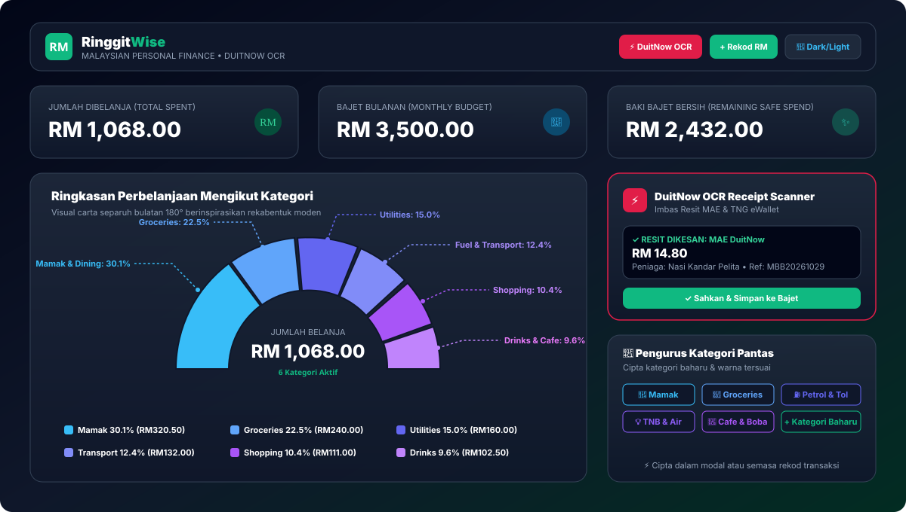
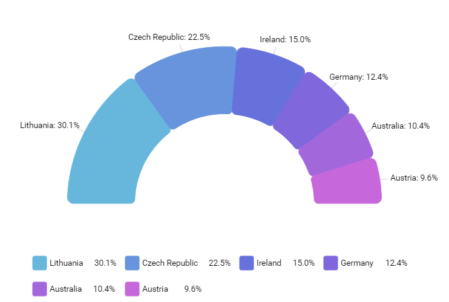

# 🇲🇾 RinggitWise — Malaysian Personal Finance & DuitNow OCR WebUI

[](https://vitejs.dev/)
[](https://react.dev/)
[](https://tailwindcss.com/)
[](https://tesseract.projectnaptha.com/)
[-10B981)](#)
[](#)

A sleek, privacy-focused Malaysian Personal Finance WebUI application built completely in **Malaysian Ringgit (RM)**. Features an **interactive half-circle category spending arch chart** (referencing Image 1), a client-side **DuitNow QR & AI OCR Receipt Scanner** for instant expense logging from e-wallet screenshots (MAE Maybank, Touch 'n Go eWallet, CIMB OCTO), in-line **custom category creation**, and seamless **Dark & Light Mode** support.

---

## 📸 App Preview

<div align="center">
  
</div>

<br/>

### 🎯 Spending Summary Half-Circle Chart Design

The centerpiece of the homepage is an **interactive 180° half-circle arc chart** inspired directly by modern data visualization standards (referencing Image 1):

<div align="center">
  <table style="border: none;">
    <tr>
      <td align="center"><b>Reference Design (Image 1)</b></td>
      <td align="center"><b>Live RinggitWise Implementation</b></td>
    </tr>
    <tr>
      <td align="center"></td>
      <td align="center"></td>
    </tr>
  </table>
</div>

- **Harmonious Arc Gradient**: Slices rendered with rounded segment contours and distinct spacing gaps.
- **Precision Leader Lines**: Angle-calculated indicator lines pointing directly from each arc slice to its label (`Category Name: XX.X%`).
- **Center Hub**: Displays total monthly spend in Ringgit (`RM 1,068.00`) and active transaction count.
- **Detailed Multi-Column Legend**: Clean rounded color chips with category names, percentages, and exact Ringgit values.

---

## ✨ Key Features

### 1. 💰 100% Malaysian Ringgit (RM) Native
- All inputs, calculations, summaries, ledger balances, and charts are strictly formatted in Malaysian Ringgit (`RM 1,234.50`).
- Built-in monthly budget tracker calculating real-time remaining balance and daily safe spending allowances.

### 2. ⚡ DuitNow QR & AI OCR Receipt Scanner
- **Client-Side AI OCR Engine** (powered by Tesseract.js):
  - Upload or snap screenshots of Malaysian payment slips and e-wallet transfers (**MAE by Maybank**, **Touch 'n Go eWallet**, **CIMB OCTO**, **GrabPay**, **Bank Islam**, **Public Bank**).
  - Automatically extracts **Transaction Amount in RM**, **Merchant / Recipient Name**, **Reference Number**, and **Date**.
  - Auto-suggests the appropriate spending category.
  - Test instantly with 1-click sample receipts (`MAE DuitNow RM14.80`, `TNG eWallet RM28.50`, `ZUS Coffee RM13.90`).
- **Live QR Scanner & Simulator**:
  - Live camera viewfinder for scanning interoperable DuitNow QR codes.
  - 1-Tap quick payment presets for popular Malaysian merchants (*Nasi Kandar Pelita*, *99 Speedmart*, *Petronas Mesra*, *Tealive*, *FamilyMart*, *Village Grocer*).
- **Dynamic DuitNow QR Generator**:
  - Generate official-spec DuitNow QR codes with custom RM amounts and notes.
- **Mamak Bill Splitter**:
  - Split hangout bills with friends using **Bank Negara Malaysia's 5-sen rounding mechanism**.

### 3. 🌙 True Dark Mode & Light Mode
- One-click instant theme toggle in the header.
- **Dark Mode**: High-contrast, sleek Slate-950/900 palette with emerald and cyan accents.
- **Light Mode**: Crisp, clean off-white canvas with dark slate typography and accessible contrast ratios.
- Automatically persists your preference in `localStorage` and respects system preferences.

### 4. 📁 Quick Category Creation & Manager
- **In-Line Quick Creation**: Add custom categories on the fly directly inside the expense logging modal without leaving the form.
- **Dedicated Category Manager**:
  - Customize category names, colors (palette matching Image 1), and emoji icons (`🍔`, `🛒`, `⛽`, `💡`, `🧋`, `🛍️`, `🎬`, `🏥`, `📚`, `📈`).
  - Real-time updates reflected across all charts and ledgers.

### 5. 📊 Real-Time Transaction Ledger
- Search expenses by merchant name, notes, or tags.
- Filter by custom category or payment method (DuitNow QR, TNG eWallet, MAE, GrabPay, Card, Cash).
- 1-Click **CSV Export** for easy tax and personal accounting tracking.

---

## 🚀 Getting Started

### Prerequisites
- Node.js (v18 or higher recommended)
- npm or pnpm

### Installation

```bash
# 1. Clone the repository
git clone https://github.com/Kwan-desu/RinggitWise.git
cd RinggitWise

# 2. Install dependencies
npm install

# 3. Start development server
npm run dev
```

Visit `http://localhost:5173` in your browser.

### Production Build

```bash
npm run build
```

The production output is generated in the `dist/` directory.

---

## 🛠️ Tech Architecture

- **UI Framework**: React 19 + Vite 8
- **Styling**: Tailwind CSS v4 with custom dark mode variants
- **OCR Engine**: Tesseract.js (pure client-side, zero backend server requirement)
- **Icons**: Lucide React
- **QR Code**: qrcode + Canvas
- **Visuals**: SVG Data Visualization (Half-Circle 180° Arc System)

---

## 📄 License

MIT License © 2026 RinggitWise Team.
