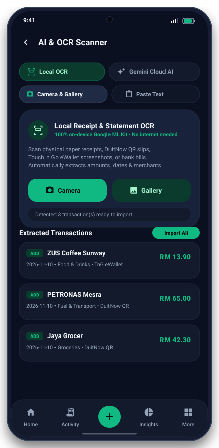

# RinggitWise

Malaysian personal finance app for Android built with Kotlin and Jetpack Compose.

[](https://github.com/Kwan-desu/RinggitWise/releases/tag/v1.2.3)
[-3DDC84?logo=android&logoColor=white)](https://developer.android.com)
[](https://kotlinlang.org)
[](https://developer.android.com/jetpack/compose)
[](#)
[](LICENSE)

Built exclusively for **Malaysian Ringgit (RM)** tracking. Includes an interactive **180° Half Pie** and **360° Donut** spending view with custom categories, **Tolong Beli** claim tracking with one-tap WhatsApp sharing, offline **Google ML Kit OCR** plus **Gemini AI** receipt scanning, recurring bill reminders, and savings goals.

---

## Preview

<div align="center">
  
</div>

<br/>

<div align="center">
  <a href="https://github.com/Kwan-desu/RinggitWise/releases/download/v1.2.3/RinggitWise-v1.2.3.apk">
    
  </a>
</div>

---

## Key Screens

<div align="center">
  <table>
    <tr>
      <th align="center" width="25%">Home & Budget</th>
      <th align="center" width="25%">Insights & Custom Categories</th>
      <th align="center" width="25%">Activity & Tolong Beli</th>
      <th align="center" width="25%">AI & OCR Scanner</th>
    </tr>
    <tr>
      <td align="center"></td>
      <td align="center"></td>
      <td align="center"></td>
      <td align="center"></td>
    </tr>
    <tr>
      <td align="center"><sub>Monthly RM budget pace, safe daily spend, quick actions & upcoming bills</sub></td>
      <td align="center"><sub>180° Arch & 360° Donut with custom category slices & center focus</sub></td>
      <td align="center"><sub>Tolong Beli claim tracking, settlement status & payment method pills</sub></td>
      <td align="center"><sub>Offline local OCR (ML Kit) & Gemini AI multimodal receipt parsing</sub></td>
    </tr>
  </table>
</div>

---

## Features

### 1. Insights & Custom Categories (`v1.2.3`)
- View monthly RM spending in **180° Half Pie** and **360° Donut** charts, **Ranked Bars**, or a 31-day daily burn timeline.
- User-created custom categories appear directly inside chart slices using their selected vector icon and color.
- Tap any category chip below the chart to focus the center readout with the exact RM total, spend share, transaction count, and a `+ Log` shortcut.

### 2. Tolong Beli Claims
- Mark expenses paid on behalf of family or friends with a recipient tag (such as `Mum`, `Roommate`, or `Bro`).
- Track payment methods with pills for **DuitNow QR**, **Touch 'n Go eWallet**, **MAE**, **Debit Card**, and **Cash**.
- Share claim summaries over WhatsApp and switch settlement status between **Unpaid** and **Settled**.

### 3. Dual-Engine Receipt Scanner
- **Local OCR (Google ML Kit, offline):** Scans paper receipts and screenshots from **Touch 'n Go eWallet**, **MAE by Maybank**, **CIMB OCTO**, and **GrabPay** locally on-device with no internet connection.
- **Cloud AI (Google Gemini):** Parses itemized bills using your own Gemini API key (`gemini-2.5-flash`, `gemini-3.5-flash-lite`) and provides a spending Q&A view.

### 4. Bills & Savings Goals
- Schedules recurring utility, rent, and subscription bill reminders in the background via **Android WorkManager**.
- Tracks progress toward individual savings targets.

### 5. UI & Theme
- Includes **Dark**, **Light**, and **System** theme modes with **Material You** wallpaper tinting and configurable surface opacity.
- Uses Material vector icons throughout the UI instead of placeholder emojis.

### 6. In-App Updater
- Checks GitHub Releases for newer builds and downloads updated APKs inside the app.

---

## Installation

Download the debug APK directly from the latest GitHub release:

- **Latest Release:** [RinggitWise-v1.2.3.apk](https://github.com/Kwan-desu/RinggitWise/releases/tag/v1.2.3)
- **Minimum Android:** Android 8.0 (API 24)
- **Target Android:** Android 16 (API 36)

---

## Build from Source

### Prerequisites
- Android Studio Ladybug or newer with JDK 17+
- Android SDK Platform 36

### Commands

```bash
git clone https://github.com/Kwan-desu/RinggitWise.git
cd RinggitWise/native-android
./gradlew assembleDebug
```

The generated APK is written to `native-android/app/build/outputs/apk/debug/app-debug.apk`.

---

## Tech Stack

| Component | Technology |
|---|---|
| Language | Kotlin 2.0 |
| UI Framework | Jetpack Compose (Material 3) |
| Offline OCR | Google ML Kit Text Recognition (`com.google.mlkit:text-recognition`) |
| Cloud AI | Google Gemini API |
| Background Work | AndroidX WorkManager |
| Local Storage | Encrypted SharedPreferences + Kotlinx Serialization |
| Image Loading | Coil Compose |
| State Management | StateFlow + Unidirectional Data Flow |

---

## License

Licensed under the MIT License. See [LICENSE](LICENSE) for full terms.
